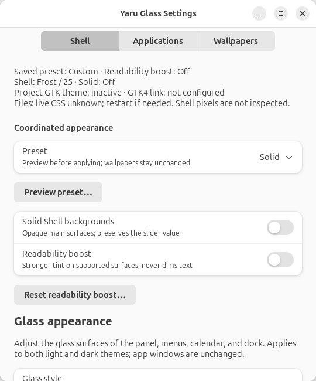

# Yaru Glass

Version **2.2.4** — Ubuntu 24.04 / GNOME Shell 46 and Ubuntu 26.04 / GNOME Shell 50.

See the [changelog](CHANGELOG.md) for release history starting at 1.0.0 and
unreleased repository changes. Contributor and agent guidance is in
[AGENTS.md](AGENTS.md).

**2.1.1 was a local branding and demo release** on the 2.1.0 dual-stack baseline.
It completes the Yaru Glass rename, clarifies Yaru reuse and licensing, and adds
an offline lock-screen concept demo. It also handles tuple-valued colors from
Blur my Shell when reapplying managed effects. It does not change desktop lock
behavior or expand supported transparency integrations. See [2.1.1 release notes and validation limits](docs/RELEASE-2.1.1.md).

**2.0.0 introduced dual-stack support.** Ubuntu 24.04 remains supported alongside
Ubuntu 26.04, with Wayland as the validated session. Logo Menu is omitted on
GNOME 50; standard Activities remains available. Search Light is no longer
installed or configured on either stack; use GNOME's built-in search instead.

See [2.0.0 release notes and validation limits](docs/RELEASE-2.0.0.md) for the
dual-stack evidence, software-rendered VM checks and original compatibility details.
Later milestones remain in the [roadmap](docs/ROADMAP.md).

**2.2.2 fixes notification animation overflow in the demo**, including the
intermittent GNOME 46 mobile-layout failures. Notifications are centered by layout
instead of an animated percentage transform, retaining the slide/fade and reduced
motion behavior. Ten complete demo runs pass on each GNOME stack.
See [2.2.2 release evidence](docs/RELEASE-2.2.2.md).

**2.2.3 adds private local diagnostics** for Settings, appearance transactions,
sync, extensions and installation. Open the **Diagnostics** Settings page,
or use `yaru-glass-logs show`, `follow`, `verbose on|off` and `export NEW_FILE.json`.
Reports are sanitized and saved locally only; nothing is uploaded. Logs retain
at most 10 MiB. See [diagnostics and privacy](docs/MANUAL.md#local-diagnostics).
Native notification shadows are also smaller, but 2.2.3 banners can still show a
square gray halo on bright backgrounds. See [2.2.3 release evidence](docs/RELEASE-2.2.3.md).

**2.2.4:** notification banners drop the Layered gradient that caused the
square halo, and Settings shows a labeled **Diagnostics** header button.
See [2.2.4 release evidence](docs/RELEASE-2.2.4.md).

**2.2.1 fixes missing/unselectable Frost/Crystal pipelines** for the panel,
popups and dock. A color serialization defect made Blur my Shell reject the
entire library in 2.2.0, despite saved Yaru entries. Reapplying managed effects
repairs it without resetting unrelated pipelines; a repair-only Blur my Shell
restart clears cached Default effects. Both styles were verified on real actors
and in extension preferences on GNOME 46/50, alongside the full 176-test suite.
See the [release evidence and limits](docs/RELEASE-2.2.1.md).

2.2.0 introduced Layered Frost/Crystal, independently controlled rounded dynamic
Shell blur, icon-colored dock dashes and the offline demo login fix. Its pipeline
acceptance claims were incomplete; use 2.2.1 for the corrected integration.

Translucent light and dark themes for Ubuntu 24.04 and 26.04, built on Yaru. Ubuntu icons are kept.

This is an **unofficial derivative** of [Yaru](https://github.com/ubuntu/yaru),
developed by the Ubuntu community, Canonical and other contributors. Yaru is
reused and modified under its component-specific open-source licences; upstream
copyrights and licence obligations remain applicable. This project is not
affiliated with or endorsed by the Yaru project or Canonical. Reuse
permissions do not themselves grant trademark rights or endorsement.
See [credits, licences and redistribution requirements](docs/MANUAL.md#10-credits-and-licences).



Try the [interactive desktop demo](demo/index.html): it starts at a simulated login
screen and opens the Ubuntu desktop after a fictional account signs in. Lock returns
to that account's lock screen; Log Out returns to account selection. The desktop's
Quick Settings, calendar, notifications, dock, Activities overview, app grid, and
Settings, Files and Terminal windows are interactive. Lock-screen wallpapers,
clock styles, and privacy-aware mock notifications are also included. Everything
runs offline in the browser; no desktop settings or authentication are changed.
See the [desktop icon credits](demo/demo-assets/desktop/ATTRIBUTION.md) and
[lock-screen asset credits](demo/demo-assets/lockscreen/ATTRIBUTION.md).

After installation, open **Yaru Glass Settings** from the application launcher to
choose **Frost / Crystal** tints, adjust transparency, and select separate light/dark
wallpapers. Changes apply automatically and are saved. Glass styles require Blur my Shell.

Settings pages are ordered **Shell**, **Applications**, **Wallpapers**,
**Diagnostics**, **Updates** in one navigation group. Diagnostics and Updates
stay inside Settings instead of opening separate windows. Logs show readable
timestamped summaries and details; exported reports remain structured JSON.
Settings-app and Files transparency are separate opt-in features. Files changes
require a full restart; the confirmed restart action opens Home, not previous tabs.
The Layered styles use rounded dynamic blur for Shell surfaces by
default. The **Dynamic background blur** switch turns it off independently; Solid
suppresses it without losing the preference. Settings and Files use illuminated
transparent tints, **not backdrop blur**. Other GTK apps stay unchanged.

**1.2.0:** preview coordinated **Solid / Balanced Frost / Clear Crystal** presets,
use an optional **Readability boost**, and reset each section with confirmation.
Solid makes main Shell backgrounds opaque; level 0 alone does not.
Presets never change wallpapers, readability boost or the saved blur preference,
and never restart Files automatically. Older preferences default dynamic blur to
on by default. Status distinguishes saved configuration from
confirmed restart; it cannot inspect a running Files process's CSS.

## Quick start

Development direction: [roadmap (Markdown)](docs/ROADMAP.md) ·
[roadmap (HTML)](docs/ROADMAP.html).

**Next feature release: 2.3.0 app updates.** The unreleased implementation adds
manual **Updates** controls in Settings and `yaru-glass-update check|install`.
Stable public GitHub releases are checksum-verified and staged without resetting
preferences, wallpapers, customized profiles or extensions. Failed/interrupted
replacement has a recovery path. Existing 2.2.4 installations need a one-time
verified-archive bootstrap after an updater-enabled release is published; they
do not already contain these controls. See [updating and bootstrap](docs/MANUAL.md#6-updating).
Custom lock screen is now later and unnumbered. `VERSION` remains 2.2.4.

**Breaking rename:** commands, theme names, app IDs and configuration paths now
use Yaru Glass. There are no legacy aliases or automatic migration. Before
switching from an earlier-branded installation, back up its preferences and
original installation backup, then run that installation's own uninstaller.
Do not use the new uninstaller to remove an earlier-branded installation.
See [switching from an earlier project name](docs/MANUAL.md#switching-from-an-earlier-project-name).

```bash
./scripts/install.sh
```

Type your password if asked, then log out and back in if the installer tells you to.

- Full documentation: **[manual](docs/MANUAL.md)** or [HTML manual](docs/MANUAL.html)
- Uninstall: `~/.local/share/yaru-glass/scripts/uninstall.sh`

## Repository layout

```text
src/yaru_glass/  shared Python modules
src/theme/      GNOME Shell and GTK theme sources
bin/            runtime commands (settings, sync, extension helpers)
scripts/        build, install, uninstall, and release tools
assets/fonts/   bundled Inter fonts and license
assets/profiles/ extension configuration defaults
docs/           manuals, roadmap, release notes, and screenshots
demo/           integrated login, lock-screen, and desktop preview with bundled assets
tests/          unit, UI, and isolated packaging tests
dist/releases/  current release archive and checksum (ignored by Git)
```

The directory name does not define the version; `VERSION` does. Release archives
and checksums are kept in `dist/releases/`; earlier archives are preserved.
Historical release notes and changelog entries remain in `docs/` and
`CHANGELOG.md`. Use the commands here for the current source tree.

## Development

From the repository root, use Ubuntu's system Python (the GTK bindings come from
Ubuntu packages):

```bash
/usr/bin/python3 -m unittest discover -s tests -p 'test_*.py' -v
bash -n scripts/install.sh scripts/uninstall.sh scripts/make-package.sh
/usr/bin/python3 scripts/render-manual.py
```

UI tests require GTK 4, libadwaita, WebKit 6, and a display; unavailable UI tests
are skipped. Rendering the manual requires `python3-markdown`.

Building themes changes the installed themes in `~/.local/share/themes`:

```bash
/usr/bin/python3 scripts/build.py
```

To package a release:

```bash
./scripts/make-package.sh             # output: dist/releases/
./scripts/make-package.sh /some/dir   # optional output directory
./scripts/make-package.sh --curated-profiles /empty/output/dir
```

Packaging exports your current extension settings into `assets/profiles/` and
regenerates the manual when its renderer is available. Review those changes
before committing. It excludes Git metadata, local state, caches, and `dist/`.
Use **`--curated-profiles` for a release built from supplied profiles without
desktop capture**. Existing same-version archives/checksums are never overwritten.
If Markdown is unavailable, packaging explicitly reports that the existing HTML
manual was included without regeneration.

## Local Git setup

The repository uses `main`. No remote or initial commit is required yet. Set a
real identity locally before your first commit; replace these placeholders:

```bash
git config --local user.name "YOUR_NAME"
git config --local user.email "YOUR_EMAIL"
git status --short --branch
```

These identity commands are examples, not preconfigured values. Existing global
Git configuration is left untouched. When ready to create your first commit:

```bash
git add .
git commit -m "Initial project layout"
```

After creating an empty GitHub repository, connect and publish it yourself:

```bash
git remote add origin https://github.com/YOUR_ACCOUNT/YOUR_REPOSITORY.git
git push -u origin main
```
