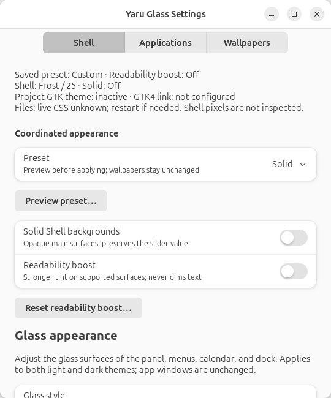
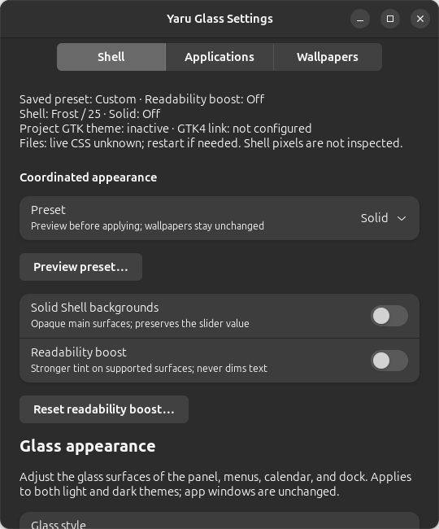
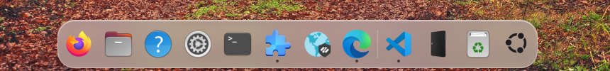

# Yaru Glass — User Manual

Version 2.3.1 · for Ubuntu 24.04 LTS (GNOME Shell 46) and Ubuntu 26.04 LTS (GNOME Shell 50)

Yaru Glass is a pair of desktop themes for Ubuntu, **Yaru-Glass** (light) and
**Yaru-Glass-dark** (dark). Both are built on top of Ubuntu's own Yaru theme with
translucent surfaces and coordinated light/dark styling. Ubuntu's Yaru icons and
the Ubuntu logo are kept.

 



---

## Contents

1. [What you get](#1-what-you-get)
2. [Requirements](#2-requirements)
3. [Installation](#3-installation)
4. [Everyday use](#4-everyday-use)
5. [Customisation](#5-customisation)
6. [Updating](#6-updating)
7. [Uninstalling](#7-uninstalling)
8. [Troubleshooting](#8-troubleshooting)
9. [Files and folders](#9-files-and-folders)
10. [Credits and licences](#10-credits-and-licences)

---

## 1. What you get

| Area | Look |
|---|---|
| **Menu bar** (top panel) | Transparent tint, slimmer, regular-weight text, clock on the right |
| **Menus, Quick Settings, calendar, notifications** | Translucent glass, large rounded corners, pill toggles, blue (`#007AFF`) highlights |
| **Dialogs** (log out, password, …) | Rounded glass card, pill buttons with spacing from the edges |
| **Dock** (Ubuntu Dock) | Floating glass dock, 24 px corners, native dashes in each app icon's dominant color |
| **App switcher, volume/brightness pop-ups** | Glass panels |
| **Windows** | Red / yellow / green buttons on the **right**; symbols show on hover, grey when the window is inactive; 14 px rounded corners |
| **Apps** | Blue accent in both older (GTK 3) and newer (GTK 4 / libadwaita) apps |
| **Font** | [Inter](https://rsms.me/inter/), an open-source interface typeface |
| **Search** | Standard GNOME search: press **Super** and type |
| **Light / dark** | Switches automatically at sunrise and sunset (Automatic Theme Switcher) or with the *Dark Style* toggle |

### Extensions installed and configured

| Extension | Purpose |
|---|---|
| User Themes | Applies the theme to the menu bar, menus, dock and dialogs |
| Blur my Shell | Rounded dynamic panel, popup and dock backgrounds; independent blur switch; unrelated effects preserved |
| Just Perfection | Moves the clock to the right |
| Logo Menu | Ubuntu 24.04 only: menu behind the Ubuntu logo (top-left); GNOME 50 uses standard Activities |
| Automatic Theme Switcher | Light theme by day, dark theme by night |
| Ubuntu Dock, Ubuntu AppIndicators | Ubuntu built-ins; enabled if present |

### 2.2.0 extension policy

These exact releases are enforced and tested on the named Ubuntu stacks.
The matrix is unchanged in 2.2.1. See
[current release evidence and validation limits](RELEASE-2.2.1.md).

| Extension | GNOME 46 | GNOME 50 |
|---|---|---|
| User Themes | 60 | 79 |
| Blur my Shell | 77 | 77 |
| Just Perfection | 37 | 37 |
| Automatic Theme Switcher | 11 | 11 |
| Logo Menu | 41 | Omitted pending real event-handler checks |
| Ubuntu Dock | Metadata 90; package `90ubuntu3` | Metadata 105; Ubuntu extension bundle `50.26.04.8ubuntu` |
| Ubuntu AppIndicators | Package `58-1ubuntu24.04.1` | Ubuntu extension bundle `50.26.04.8ubuntu` |

Ubuntu AppIndicators has no numeric version in its metadata, so the policy checks
its Ubuntu package instead. Installation checks pinned archive metadata and
required profile schemas; enabling checks the installed release. Managed blur
also checks the active release and rounded dynamic renderer. Existing mismatches
are reported, not silently replaced or downgraded. Automatic extension/system
updates can move outside this policy; do not automatically downgrade security
updates to satisfy it. A revised policy needs new validation.
`--no-extensions` avoids installing/enabling extensions; `--theme-only` also
avoids importing their settings. Both skip the independent Lock Screen companion.
See the installed helper diagnostics for the required release.
Enabling uses one batch request and waits for the Shell's reported state.
An accepted request is not proof of activation. If managed appearance cannot
activate, the installer exits with an error after explaining that files were
installed but appearance is incomplete. Check Extension Manager, log out/in,
and rerun the installer; do not treat that state as a successful installation.

---

## 2. Requirements

- **Ubuntu 24.04 LTS / GNOME Shell 46** or **Ubuntu 26.04 LTS / GNOME Shell 50**
  with the standard Ubuntu desktop. Wayland is the validated session.
  Other Ubuntu/GNOME versions are untested.
- An internet connection during installation, to download the extensions.
- Your user password (only for installing missing system packages with `sudo`).

See [2.0.0 validation and limits](RELEASE-2.0.0.md), including the software-rendered
Ubuntu 26.04 test VM and isolated lifecycle checks. Finish Ubuntu's first-run
wizard before installation; its appearance page can reset custom GTK themes.
Logo Menu is not installed, enabled or configured
on GNOME 50 because release 45 logs an unimplemented event-handler error.
Existing independently installed extensions are left alone. Its upstream fix
will be rechecked before each project release; support is not inferred from
extension metadata alone.

The installer adds these Ubuntu packages if they are missing:
`yaru-theme-gtk`, `yaru-theme-gnome-shell`, `yaru-theme-icon`, `yaru-theme-sound`,
`gnome-shell-extension-ubuntu-dock`, `gnome-shell-extension-appindicator`,
`gnome-shell-extension-manager`, `python3`, `python3-gi`, `gir1.2-glib-2.0`,
`libglib2.0-bin`, `gir1.2-gtk-4.0`, `gir1.2-adw-1`, `gir1.2-gdkpixbuf-2.0`, `dconf-cli`, `curl`, `unzip`,
`fontconfig`.

---

## 3. Installation

### Switching from an earlier project name

This is a breaking rename, not an automatic upgrade from an earlier-branded
installation. Commands, desktop app IDs, theme names, configuration paths and
the sync service now use Yaru Glass. No legacy aliases are installed.

1. Back up the earlier installation's preference files and original installation
  backup to a separate location.
2. Run the earlier installation's own uninstaller to restore its managed desktop
  settings and stop its sync service. Do not use this version's uninstaller for
  that installation. Do not purge anything before making the backup.
3. Install Yaru Glass from the current source or a newly built package. This
  creates a new first-install backup after the earlier theme has been removed.
4. To retain appearance choices, copy only `settings.json`, `app-appearance.json`
  and `files-appearance.json` from your saved preferences into
  `${XDG_CONFIG_HOME:-$HOME/.config}/yaru-glass/` before opening Settings.
  Do not copy managed-effect/wallpaper ownership state, service files or old
  installation backups into the new installation.

The source rename does not modify an existing installation or rebuild historical
archives. The package commands below illustrate the new naming convention; use
the actual filename and version of your newly supplied package.

### Installing a package

1. Copy `yaru-glass-theme-2.0.0.tar.gz` and its `.sha256` file to the target computer.
2. Open **Terminal** in the folder that holds the file and run:

   ```bash
   sha256sum -c yaru-glass-theme-2.0.0.tar.gz.sha256
   tar xzf yaru-glass-theme-2.0.0.tar.gz
   cd yaru-glass-theme-2.0.0
   ./scripts/install.sh
   ```

3. Answer **Y**, and type your password if asked.
4. If the installer says **"New extensions were installed — log out and log back in"**,
   do so. On Wayland, GNOME only loads new extensions after a fresh login.
5. Restart any apps that were open.

> Run the installer as your normal user, **not** with `sudo`. It asks for the password
> itself when it needs it.

### Installer options

| Option | Effect |
|---|---|
| `--no-apt` | Skip system packages (no password prompt). Use when everything is already installed. |
| `--no-extensions` | Don't download or enable extensions |
| `--theme-only` | Install the themes, font and sync service, but keep your current dock and extension settings |
| `-y`, `--yes` | Don't ask for confirmation |
| `-h`, `--help` | Show help |

### What the installer does, step by step

1. Installs missing system packages (asks for your password).
2. Copies itself to `~/.local/share/yaru-glass`.
3. **Backs up** your current appearance and extension settings to
   `~/.local/share/yaru-glass/backup/original` (only on the first install).
4. Installs the bundled Inter font to `~/.local/share/fonts/Inter`.
5. Downloads the extensions above from extensions.gnome.org (the right version for your
   GNOME) and enables them. Extensions you already have are left as they are.
6. Builds the two themes into `~/.local/share/themes` from your system's Yaru theme.
7. Applies fonts and the settings profile (dock, Blur my Shell, clock position, Search
   Light, …).
8. Sets up the background service `yaru-glass-sync` (see 4.2).
9. Activates the light or dark theme to match your current *Dark Style* setting.

You can run the installer again at any time. It is safe to repeat, and your original
backup is never overwritten.

---

## 4. Everyday use

### 4.1 Light and dark

You can switch in either of these ways:

- **Automatically:** Automatic Theme Switcher uses the light theme from sunrise and the
  dark theme from sunset, based on your location. To change the times or triggers, open
  **Extension Manager → Automatic Theme Switcher → ⚙**.
- **Manually:** use the **Dark Style** toggle in Quick Settings (top-right menu).

Both ways switch everything together: apps, menu bar, menus and dock.

### 4.2 The sync service

`yaru-glass-sync` runs in the background and keeps all parts of the theme on the same
variant. Without it, newer GNOME apps or the menu bar could stay light while the rest
turns dark. It only acts while one of the Yaru Glass themes is selected. If you choose a
different theme, it removes its own tweaks automatically.

```bash
systemctl --user status yaru-glass-sync     # check it is running
systemctl --user restart yaru-glass-sync    # restart it
journalctl --user -u yaru-glass-sync        # its log
```

### 4.3 Search

Press **Super** (the Windows/⌘ key), type, then press **Enter** to use GNOME's
built-in search. The theme no longer installs or configures Search Light on either
Ubuntu stack, and new installs leave keyboard-layout shortcuts unchanged.
Upgrades leave any existing Search Light installation and settings alone; disable
or remove it in Extension Manager if unwanted. Original backups and installer
ownership records are retained so uninstall can still restore earlier settings.

### 4.4 Choosing the theme manually

The themes are listed as **Yaru-Glass** and **Yaru-Glass-dark**, for example in
GNOME Tweaks. Selecting either one is enough; the sync service picks the matching menu
bar theme and Dark Style setting.

---

## 5. Customisation

### Theme transparency

Open **Yaru Glass Settings** from the application launcher, or run
`~/.local/bin/yaru-glass-settings`.

The window has five pages: **Shell** for glass style and Shell transparency,
**Applications** for Settings-app and Files transparency, presets and restart,
**Wallpapers** for the light/dark image previews and pickers, then **Diagnostics**
and **Updates**. All five share one navigation group; diagnostics and update
controls are inline pages, not separate windows. Each page scrolls
independently. At narrow window widths, page navigation switches to a compact
drop-down; the pages scroll vertically without horizontal scrolling. Switching
pages does not apply, reset or save any settings.
Status and Retry controls stay beside their corresponding settings; Shell/app/Files
errors select the relevant page so they are not hidden.

Choose **Frost** (default, stronger tint) or **Crystal** (clearer tint).
Version 2.2.0 adds **Layered** lighting and reflections.
**Dynamic background blur** is on by default and samples windows behind Shell
surfaces, rather than a separate wallpaper image. The independent switch disables
blur without disabling the layered tint. **Solid** suppresses effective blur
without changing the saved preference. Older preference files default to blur on.
Blur my Shell must be enabled and running with the required rounded rendering
capabilities. Other pipelines/effects are left alone. Leaving this theme restores
managed extension settings; returning reapplies the saved style and blur preference.
Version **2.2.1** fixes a 2.2.0 color encoding bug that hid all six managed
pipelines from Blur my Shell and caused Default fallback. Upgrading and reapplying
the saved appearance repairs the existing library, preserving unrelated effects
and color values; do not reset the library manually. Repair briefly disables and
reenables Blur my Shell, waits for its active state and rebuilds cached panel,
popup and dock effects. Ordinary style changes do not restart the extension.
If preferences were already open, close and reopen them after upgrading.
The [2.2.1 release notes](RELEASE-2.2.1.md) distinguish actual parser/preferences
and running-actor checks from remaining visual limits. Extension metadata or
automated CSS checks alone are not desktop certification.

The **0–50%** slider increases transparency within the chosen style. **25%** is the
default; **Reset Shell appearance…** asks for confirmation and restores Frost/25,
with Solid off and blur on. It preserves readability boost and app/Files/wallpaper settings.
Text-bearing surfaces retain a protective tint for readable text, so **0%** is not
fully opaque and **50%** is not invisible. The popup tint has been strengthened
compared with the earlier theme to avoid faint labels over bright/dark content.
Changes apply automatically after a short pause, to both light and dark variants.
Close and reopen a popup if needed to see the change.

This changes the panel, menus, calendar popup, dock, and other Shell surface fills,
not GTK app windows, text, borders, or solid accent colors. The slider does not
change blur strength: Frost uses a softer, stronger blur and Crystal a clearer one.
App backgrounds remain unblurred. Layered gradients preserve protective tint alpha;
popup and dock reflections do not add border geometry. Notification banners use a
flat tint with a small rounded shadow. Notification headers, icons and
timestamps use the full foreground colour. The plain calendar and today's marker
are preserved.

The app shows when a value has been applied and saved, or displays an error with a
Retry button. Closing while a change is pending waits for it to finish; a failure
keeps the window open. Settings are stored in
`~/.config/yaru-glass/settings.json` (or under `$XDG_CONFIG_HOME`) and are reused by
future builds and reinstalls. Normal uninstall preserves them; `--purge` removes them.
Choosing a level does not switch you away from a different GTK/Shell theme.
Failures restore the previous generated CSS and managed effects where possible;
any restoration failure is reported rather than marked successful.

### Coordinated presets, Solid and readability boost

On the Shell page, select a preset and choose **Preview preset…**. The dialog shows
current and target values grouped under Shell, Settings app and Files, with
readable names and values (for example, `Transparency level: 25% → 50%`).
Cancel is the default and changes nothing.

| Preset | Shell | Settings app | Files |
|---|---|---|---|
| Solid | Frost / 0, Solid on | Off / 25 | Off / 25 |
| Balanced Frost | Frost / 25, Solid off | On / 25 | On / 25 |
| Clear Crystal | Crystal / 50, Solid off | On / 50 | On / 50 |

Levels are relative, not literal alpha percentages. Applying changes enablement
as shown, but **never changes wallpapers, readability boost or blur preference, and never restarts
Files automatically**. The saved preset label is derived from actual settings;
individual edits may make it **Custom**.

**Solid Shell backgrounds** is also available independently. It makes primary
panel/menu/calendar/Quick Settings/notification/dialog/dock/switcher/OSD fills
opaque. The slider is disabled, retaining its value until Solid is turned off.
Effective Shell blur is also disabled until Solid is turned off.
Hover, focus and selection overlays keep their normal behavior.

**Readability boost** is off by default. It halves the remaining backdrop
contribution to supported primary Shell, enabled Settings and enabled Files
backgrounds: `boosted alpha = alpha + (1 - alpha) / 2`. For example, Files at
Crystal/50 becomes 85% opaque rather than 70%. Disabled integrations remain off;
Solid takes precedence. Sliders, text/icon opacity and solid file content/controls
are unchanged. The separate boost reset asks for confirmation and switches it off.
This is not GNOME's High Contrast theme or a guarantee on every backdrop.

The overview distinguishes selected GTK theme/GTK4 link state, saved values and
unknown live Files CSS. Shell reload is requested, not pixel-inspected. An inactive
project theme is not automatically activated. A confirmed Files restart is valid
only for this session and is invalidated by later relevant changes.
Coordinated operations share a lock and restore prior preferences, CSS and managed
effects on handled failure; restoration errors are shown explicitly. An unexpected
process interruption is not a filesystem-wide transaction guarantee.
If preferences cannot be read, the app labels its displayed defaults as unsaved.
Reset and repair confirmations list the affected sections and show readable
before/after values instead of a raw settings dump. **Repair invalid preferences…**
on the Shell page confirms replacement of only the invalid sections, including
when several files are malformed; an unreadable previous value is identified as
unavailable rather than shown as the fallback default.
Valid sections and wallpapers stay unchanged; filesystem permission failures
must still be resolved before a save can succeed.

### Settings app transparency (experimental)

The separate **Settings app transparency** section affects only Yaru Glass Settings,
not Files or other GTK apps. It is **off by default**. Enable it and use its own
**0–50%** slider; 0% is opaque and 25% is the initial level. Changes apply and save
after a short pause through the shared worker, without rebuilding the Shell.
The window changes only after saving succeeds. **Reset Settings app…** confirms
before restoring off/25; other sections stay unchanged.

Explanatory labels and titlebar text use the full foreground colour when enabled,
rather than reduced-opacity text, to preserve contrast over windows underneath.
The background and titlebar become transparent over windows underneath, without
blur. Controls retain solid backgrounds and text/icons stay fully opaque. The tint
follows the successfully applied Frost/Crystal style and GNOME's light/dark scheme.
Turning it off restores the normal solid appearance.

These preferences are stored separately in `~/.config/yaru-glass/app-appearance.json`
(respecting `$XDG_CONFIG_HOME`). A save failure leaves the previous appearance in
place and offers Retry. Normal uninstall keeps this preference; `--purge` removes it.

### Files transparency (experimental)

The separate **Files transparency** section is off by default. Enable it and use
its **0–50%** slider (initially 25%; 0% is opaque). Only Files' sidebar and
headerbars become transparent. The main file area stays solid, and text, icons,
selection markers and menus retain their existing styling. Other GTK apps and
the Settings-app slider are unchanged. There is no background blur.

Tint follows Frost/Crystal and the system light/dark colours. Changes save both
theme variants and are retained by future builds. **Fully quit and reopen Files**
after changing its controls, Frost/Crystal, or the active theme: GTK may not reload
user CSS in a running process. Finish file transfers first. If closing all Files
windows does not suffice, run `nautilus --quit`, then reopen Files. Closing windows
alone can leave the background Files service running with the old stylesheet.
At 10% the Crystal tint is 94% opaque with boost off: the effect is deliberately subtle;
increase the Files slider toward 50% for a more visible effect. The settings app
never closes Files automatically. The **Restart Files…** button asks for explicit
confirmation and warns you to finish all transfers. Cancel is the default.
On confirmation it requests a normal quit, waits for the Files D-Bus service to
exit, then opens your Home folder. Existing windows/tabs are not restored.
If quit/open fails or the service does not exit within 10 seconds, an error is
shown; Files is never force-killed.

**Solid**, **Subtle**, **Balanced**, and **Clear** presets select off/0, on/10,
on/25, and on/50 respectively. These are Files-only shortcuts, distinct from
coordinated presets. **Reset Files appearance** asks for confirmation, disables the effect and
returns its slider to 25 without changing Shell or Settings-app preferences.
Files changes explicitly show **Saved — restart required**, distinct from
**Files restarted with the saved appearance** after a successful restart.
On launch the app cannot know whether Files has loaded the saved CSS, so it does
not report the effect as live.
The **Saved background** label shows the actual opacity and see-through amount
for the saved Files level, applied Frost/Crystal style and readability boost. It describes the saved
CSS, not a guarantee that a running Files process has reloaded it. The slider
remains a relative level; the file content stays fully opaque. Restart Files
after preset/reset changes too.

This experimental integration has been verified on Nautilus 46 and 50 within
the [documented validation limits](RELEASE-2.0.0.md). It uses selectors rooted in
`window.nautilus-window` in our existing GTK4 overrides, which are linked only while
a Yaru Glass theme is active. To revert, disable the switch and restart Files.
The main content stays solid by design; there is no option to make it transparent.
Preferences live in `~/.config/yaru-glass/files-appearance.json` (respecting
`$XDG_CONFIG_HOME`). Save failures show an error/Retry and attempt CSS rollback.
Normal uninstall retains the preference; `--purge` deletes it.

### Light and dark wallpapers

In **Yaru Glass Settings**, select **Choose image…** under Light wallpaper and Dark
wallpaper. GNOME uses these for its light/dark color scheme, including automatic
switches. Choose readable local images such as JPEG or PNG. Images are not copied:
keep the originals in place. Cancelling the picker changes nothing.

These controls use GNOME's `picture-uri` and `picture-uri-dark`, not a separate
scheduler. Each selection includes a small, aspect-ratio-preserving image preview.
Missing or unsupported images display a preview error without changing the wallpaper.
The display reflects external wallpaper changes too. Lock-screen and
image layout settings are unchanged.

**Restore previous** restores the value saved just before this app first edited
that slot, unless you have since chosen a different wallpaper outside this app.
Uninstall follows the same rule, leaving later external choices intact.
Backups live under `~/.config/yaru-glass` (respecting `$XDG_CONFIG_HOME`) and are
kept if restoration fails.

The [HTML demo](../demo/index.html) starts at fictional account selection, opens
the simulated Ubuntu desktop after sign-in, returns to the lock screen when
locked, and returns to account selection after log out. Its controls do not
change your actual desktop settings. Use the simulated Settings window's
**Wallpapers** page to compare surfaces over photo, white and dark wallpapers;
browser blur and contrast are approximations, not a compositor-level guarantee.
Version 2.2.2 keeps notification banners centered throughout their slide/fade
animation on mobile layouts. Reduced motion still disables the animation.

### Editing theme sources

All sources are in `~/.local/share/yaru-glass`. After any change, rebuild:

```bash
~/.local/share/yaru-glass/scripts/build.py
```

The menu bar, menus and dock reload immediately. Restart apps to see app changes.

| What | Where |
|---|---|
| Transparency level | Yaru Glass Settings (application launcher) |
| Frost / Crystal and paired wallpapers | Yaru Glass Settings (application launcher) |
| Base glass colours and accent colour of menu bar / menus / dock | `VARIANTS` in `scripts/build.py` (`panel_bg`, `menu_bg`, `dock_bg`, `accent`, …); saved transparency is applied to surface fills |
| Menu bar, menus, dock, dialogs: sizes and corners | `src/theme/gnome-shell/glass.css.in` |
| Older apps (GTK 3): window buttons, menus | `src/theme/gtk-3.0/glass.css` |
| Newer apps (GTK 4 / libadwaita): accent, window buttons, corners | `src/theme/gtk-4.0/libadwaita.css` |
| Layered tint and dynamic Shell blur | Frost / Crystal and Dynamic background blur in Yaru Glass Settings |
| Dock size, auto-hide, position | Settings → Ubuntu Desktop → Dock |

> **Tip:** the app manages rounded live Shell blur automatically; no manual Blur my
> Shell configuration is needed. Settings/Files remain tint-only, and switching
> away restores project-owned extension settings.

### Making your own package

When you have tweaked things the way you like, create a new package that includes your
current extension settings:

```bash
./scripts/make-package.sh             # writes to dist/releases/ in this project
./scripts/make-package.sh /some/dir    # or elsewhere
./scripts/make-package.sh --curated-profiles /empty/output/dir
```

Run these commands from the source or installed project root. Packaging updates
`assets/profiles/` from your current extension settings. Review those changes
before committing. To change the version number, edit `VERSION` before packaging.
For curated releases use `--curated-profiles`: it skips live capture and preserves
the supplied profiles. Existing archives or checksums are never overwritten.
Missing Markdown rendering is reported; the existing HTML manual is then required.

---

## 6. Updating

### App updates (2.3.0)

In an updater-enabled installation, open **Yaru Glass Settings → Updates**,
choose **Check for updates**, then confirm **Install update**. Checks happen only
when requested. Public stable GitHub releases require no login; drafts,
prereleases, equal versions and older versions are not installed.

```bash
yaru-glass-update check
yaru-glass-update check --json
yaru-glass-update install              # interactive confirmation
yaru-glass-update install --yes        # explicit non-interactive confirmation
```

The CLI returns 0 for successful checks, installation, cancellation or recovery,
3 when busy, and 1 on error. JSON `status` distinguishes `available`,
`up-to-date`, `installed`, `cancelled`, `recovered`, `no-recovery-needed`, `busy`
and `error`. `install --target VERSION` refuses a changed release instead of
silently installing a different version.

Updates affect only the current account's existing installation. Preferences,
independent transparency opt-ins, wallpapers, customized profiles, extensions,
ownership records and the original installation backup are preserved. No apt,
sudo, automatic checks, telemetry, remote account management or profile import
is involved. Close Settings and reopen it from the application launcher after
success. A Shell reload request is not proof of compositor output. Files is
never restarted automatically; restart it yourself after finishing transfers.
An inactive project theme is not selected automatically.

The updater requires the versioned release archive and SHA-256 companion.
Downloads are HTTPS-only, bounded and checksum-verified; archive paths, types,
size, version and required payload are validated before installed files change.
Checksums and optional GitHub asset digests establish integrity against GitHub's
release metadata, **not an independent publisher signature**.
Network/TLS failures, GitHub rate limits, missing assets and verification failures
are errors, not an "up to date" result. Retry after resolving the reported cause.

### One-time bootstrap for existing accounts

2.2.4 and earlier installations do not gain an update button retroactively.
After the updater-enabled release is published, close all old Settings windows,
finish appearance changes, and use its verified archive once on each account.
Older development installations may already have an Updates page but fail with
**Unexpected release payload path**: their validator does not allow the
`CONTRIBUTING.md` and `SECURITY.md` files added to the released package. Those
installations also need this one-time bootstrap using the downloaded updater;
retrying the old Settings updater cannot replace its own validator.

The example below installs 2.3.1. Use a new empty directory and inspect the
release notes first. Start only after the release archive and checksum are published.

```bash
mkdir yaru-glass-bootstrap-2.3.1
cd yaru-glass-bootstrap-2.3.1
curl --fail --location --proto '=https' --proto-redir '=https' \
  -O https://github.com/michajan28/yaru-glass-theme/releases/download/v2.3.1/yaru-glass-theme-2.3.1.tar.gz
curl --fail --location --proto '=https' --proto-redir '=https' \
  -O https://github.com/michajan28/yaru-glass-theme/releases/download/v2.3.1/yaru-glass-theme-2.3.1.tar.gz.sha256
sha256sum --check yaru-glass-theme-2.3.1.tar.gz.sha256
# Continue only if checksum verification succeeded.
tar -xzf yaru-glass-theme-2.3.1.tar.gz
/usr/bin/python3 yaru-glass-theme-2.3.1/bin/yaru-glass-update install --bootstrap \
  --archive "$PWD/yaru-glass-theme-2.3.1.tar.gz" \
  --checksum "$PWD/yaru-glass-theme-2.3.1.tar.gz.sha256"
```

Bootstrap re-verifies and validates the local archive, uses the same preserving
transaction, and installs the updater command. There is no second download or
`curl | sh`. Do not rerun the normal installer for a preservation-only update:
it can reapply fonts, icons, profiles and activation. Synthetic 2.2.4-layout
bootstrap is tested; arbitrary historical or earlier-branded layouts are not
promised. Fresh installations still use the normal installer.

### Independent Lock Screen extension

Lock Screen is an independent GNOME 46/50 extension, not a Yaru Glass Settings
page. It has its own Preferences window, schema and versioned ZIP; the theme
updater is unchanged and does not install or update the extension. Existing
theme users install the supplied ZIP explicitly rather than updating/reinstalling
the theme just to obtain it.

Download `lockscreen@yaru-glass-v1.shell-extension.zip` and its `.sha256` file
from the **2.4.0 GitHub release**. In the download directory:

```bash
sha256sum --check lockscreen@yaru-glass-v1.shell-extension.zip.sha256
gnome-extensions install ./lockscreen@yaru-glass-v1.shell-extension.zip
```

Or build a ZIP from source into a new output directory:

```bash
/usr/bin/python3 scripts/make-lockscreen-extension.py /path/to/empty/output
gnome-extensions install /path/to/empty/output/lockscreen@yaru-glass-v1.shell-extension.zip
```

Normal theme installation also installs this local companion, initially off.
`--no-extensions` and `--theme-only` skip it. The installer leaves compatible
existing copies alone and refuses incompatible or symlinked collisions.
After a new install, log out/in if the extension is not yet listed, then:

1. Enable **Yaru Glass Lock Screen** in Extensions or Extension Manager.
2. Open its **Preferences** (or run `gnome-extensions prefs lockscreen@yaru-glass`).
3. Turn on **Custom lock-screen appearance** and choose wallpaper, clock and
   appearance options. The extension toggle and customization preference are
   separate; neither bypasses GNOME's global extension policy.

**Follow desktop** removes the independent wallpaper override. Reset asks for
confirmation, turns customization off and resets only its own appearance
choices. It does not change desktop preferences or extension activation.
GNOME retains native authentication and notification privacy; GDM is unchanged.

For a deliberate extension upgrade, inspect the new ZIP/version, close Preferences,
and use `gnome-extensions install --force NEW_EXTENSION.zip`, then log out/in to
load the new code. This is an explicit extension operation, not a theme update.
The installer never performs that replacement automatically.

The source is GPL-3.0-or-later; its ZIP includes COPYING and NOTICE, but no theme
assets, fonts or wallpapers. The earlier intermittent GNOME 50 re-enable freeze
did not reproduce in a bounded standard disable/enable check of the independent
extension. No root cause or fix is claimed. The owner confirmed the custom lock
screen works on their account. Activation remains in Extensions/Extension Manager;
no Yaru Glass app integration is planned for this release.

### Failed or interrupted updates

Before replacement, the updater stages complete app/themes and records private
recovery state outside the package. Concurrent lifecycle/appearance operations
are excluded; the original sync running state is restored without enabling a
disabled service. Replacement across directories is recoverable, not one
indivisible filesystem operation.

An ordinary failure attempts to restore the prior package/themes and affected
runtime state. If restoration fails, the error is explicit and recovery data is
retained. Do not delete it or run the installer over it. Recover before retrying:

```bash
yaru-glass-update recover
# If the installed package/launcher is unavailable:
/usr/bin/python3 ~/.local/share/yaru-glass-update/runner/bin/yaru-glass-update recover
```

The private `~/.local/share/yaru-glass-update/` directory contains the recovery
runner, a coordination lock and, while needed, a transaction journal/backups.
Successful transactions clean their staging/backups. Ordinary uninstall retains
the runner; purge removes known runner/staging paths and the updater launcher,
but keeps the empty coordination inode. The first-install backup is separate
from temporary update recovery; user-exported reports are not deleted.
There is no manual downgrade/history command in this milestone.

### System Yaru and extensions

- **After Ubuntu updates the Yaru theme:** run `~/.local/share/yaru-glass/scripts/build.py`
  to rebuild on top of the new Yaru.
- Extensions can be updated through **Extension Manager**, but the
  exact-version policy rejects unvalidated releases; check compatibility first.

---

## 7. Uninstalling

```bash
~/.local/share/yaru-glass/scripts/uninstall.sh                       # restore previous settings
~/.local/share/yaru-glass/scripts/uninstall.sh --remove-extensions   # …and remove extensions the installer added
~/.local/share/yaru-glass/scripts/uninstall.sh --purge               # …and delete themes, font, service and files
```

The uninstaller restores the settings saved before the first install: theme, fonts,
shortcuts, enabled extensions and extension settings. Before `--purge` deletes the
folder, it copies the backup to `~/.local/share/yaru-glass-backup-<date>`.
System packages installed with apt are kept, since they are standard Ubuntu packages.
Log out and back in afterwards for a completely clean state.

The independent Lock Screen extension follows existing extension ownership:
`--remove-extensions` removes it only if the theme installer added it. A copy
installed independently or already present is not recorded as installer-owned.
Theme purge does not reset its independent preferences. To remove an independently
installed copy, disable it in Extensions and use Extension Manager or
`gnome-extensions uninstall lockscreen@yaru-glass`. Log out/in to unload cached code.

---

## 8. Troubleshooting

| Problem | Solution |
|---|---|
| Menu bar and dock still look like normal Ubuntu | Log out and back in, because new extensions load only after login. Then check that **User Themes** is enabled in Extension Manager. |
| An app still has orange accents or square buttons | Restart the app. |
| **Firefox, Thunderbird and other Snap apps** use plain Yaru | Snap apps can't read themes from your home folder. This is a Snap limitation. |
| Newer apps stay light in dark mode (or vice versa) | `systemctl --user restart yaru-glass-sync` |
| Blur sticks out past rounded corners | Match the corner radii in Blur my Shell with the theme (see the tip in section 5). |
| Something looks broken after an Ubuntu upgrade | Run `scripts/build.py` again. If it persists, `scripts/uninstall.sh` returns you to the previous setup. |
| Installer stops: "missing …Yaru-blue…" | `sudo apt install yaru-theme-gtk yaru-theme-gnome-shell` |

Useful logs:

```bash
journalctl --user -u yaru-glass-sync -b           # sync service
journalctl -b /usr/bin/gnome-shell | grep -i theme  # GNOME Shell theme loading
```

### Local diagnostics

Available starting with version 2.2.3.
In Yaru Glass Settings, choose **Diagnostics** immediately after **Wallpapers**
in the page navigation. (2.2.3 used an unlabeled header icon; 2.2.4 a labeled
header button.) View up to 200
recent sanitized events, filter by minimum level, refresh, copy the visible
events, or enable optional verbose logging. Events are newest first, with local
timestamps and UTC offsets, emphasized severity/action summaries, and indented
details and operation IDs instead of raw JSON. Copy uses this readable text;
export remains sanitized structured JSON. Reads and exports run in the
background; storage/export failures appear explicitly, never as confirmed success.

The command-line equivalent is:

```bash
yaru-glass-logs show --limit 200 --level INFO
yaru-glass-logs follow --level WARNING
yaru-glass-logs verbose on
yaru-glass-logs verbose off
yaru-glass-logs export ./new-diagnostic-report.json
```

INFO, warnings and errors are recorded by default. Verbose mode adds safe DEBUG
events, not extra personal data. Key operations include apply/rollback, managed
pipeline repair, extension activation, sync failures/recovery, wallpaper actions,
confirmed Files restart requests and installation outcomes. An operation ID
correlates Settings with its worker and lifecycle scripts with their helpers.
Reload requests remain distinct from verified live appearance.

Logs are JSON Lines in `${XDG_STATE_HOME:-~/.local/state}/yaru-glass/`:
`events.jsonl` and four rotated siblings, each at most 2 MiB (10 MiB total).
The directory is private (0700), files are 0600. A separate lock coordinates
writers; a busy/unwritable log emits a bounded stderr warning without breaking
the appearance action. The viewer/CLI reports unavailable storage. Invalid
records are counted and omitted, never displayed as raw text.

**Privacy:** logs retain allowlisted actions, outcomes, selected non-personal
fields, error categories and repository file basenames/line numbers. They omit
exception messages, credentials, personal paths, wallpaper names, environment,
raw commands/output, complete preferences, backups and journal dumps.
**Save report…** explains its contents and asks for a local destination.
The destination dialog stays open until you save, cancel, or close Settings.
Export includes up to 1,000 sanitized recent events, project/Python/Ubuntu/GNOME
versions and known extension states/compatibility where available. Existing files
are never overwritten. Reports are private JSON files; review them before sharing.
There are no automatic uploads or telemetry.

Upgrades and ordinary uninstall retain logs for diagnosis. `--purge` removes only
known diagnostic logs/preferences, leaving the empty coordination lock inode to
avoid racing a concurrent writer. Reports saved elsewhere and unknown files are
not removed. No diagnostics operation changes appearance or restarts Files.

---

## 9. Files and folders

```
~/.local/share/yaru-glass/          installed copy of this package
├── scripts/                        build, installer, uninstaller, packaging
├── src/yaru_glass/                 shared Python modules
├── src/theme/                      CSS sources (Shell, GTK 3, GTK 4)
├── assets/profiles/                extension settings applied by the installer
├── assets/fonts/Inter/             bundled Inter font (SIL OFL)
├── bin/                            settings, sync, and runtime helpers
├── docs/                           manual, roadmap, releases, and screenshots
├── tests/                          regression tests
├── backup/original/                your settings from before the first install
└── state/                          extensions added by the installer
~/.local/share/themes/Yaru-Glass[-dark]/   generated themes
~/.config/gtk-4.0/gtk.css           link to GTK 4 overrides (managed by the sync service)
~/.config/systemd/user/yaru-glass-sync.service
~/.local/share/applications/org.yaru.glass.Settings.desktop
~/.local/bin/yaru-glass-settings    native transparency settings app
~/.config/yaru-glass/settings.json saved transparency (25% by default)
```

---

## 10. Credits and licences

### Yaru origin and reuse

Yaru Glass is an unofficial derivative of [Yaru](https://github.com/ubuntu/yaru),
developed by the Ubuntu community, Canonical and other contributors. Original
copyrights and licences remain with their respective holders. This project adds
glass-style theme overrides, appearance controls, and Settings/sync tooling; these
changes are not official Yaru releases.

Yaru has mixed licensing, not a single licence covering every component. Its
[Copying or Reusing notice](https://github.com/ubuntu/yaru#copying-or-reusing)
permits copying, redistribution and modification under each applicable licence:

- **Yaru icon assets:** source SVG and rendered PNG assets are licensed under
  [Creative Commons Attribution-ShareAlike 4.0](https://creativecommons.org/licenses/by-sa/4.0/).
  Sharing them requires the applicable attribution and notices; shared adaptations
  must indicate changes and use a licence permitted by the ShareAlike terms.
- **Scripts included in upstream Yaru:** licensed under the
  [GNU General Public License, version 3](https://www.gnu.org/licenses/gpl-3.0.html).
  Redistributing covered scripts or modifications requires compliance with that
  licence, including applicable notices and source-code requirements.
- **Other Yaru components:** consult the relevant file headers, licence files and
  [upstream copyright inventory](https://github.com/ubuntu/yaru/blob/master/debian/copyright).
  Do not assume the icon or script licence applies to every stylesheet or asset.

The build uses Yaru files installed on the host: GTK resources are linked, while
Yaru Shell stylesheets and assets are copied and modified in generated themes.
Generating a theme locally does not remove upstream licensing obligations.
When redistributing Yaru-derived material, retain the applicable copyright and
licence notices, provide attribution and identify modifications as required, and
provide corresponding source in the manner required by the applicable licence.
Renaming a derivative does not remove those obligations.

Permission to reuse code or assets does not itself grant trademark rights or
endorsement. This project is not affiliated with or endorsed by the Yaru project,
or Canonical; its name does not assert official status or trademark permission.
Ubuntu and Canonical are registered trademarks of Canonical Ltd.

### Other components

- **Inter** by Rasmus Andersson, SIL Open Font License 1.1 (`assets/fonts/Inter/LICENSE.txt`).
- Extensions are downloaded from extensions.gnome.org and remain under their authors'
  licences.
- Browser-demo photographs and icons have separate terms documented in the
  [lock-screen demo credits](../demo/demo-assets/lockscreen/ATTRIBUTION.md) and
  [desktop demo credits](../demo/demo-assets/desktop/ATTRIBUTION.md).
